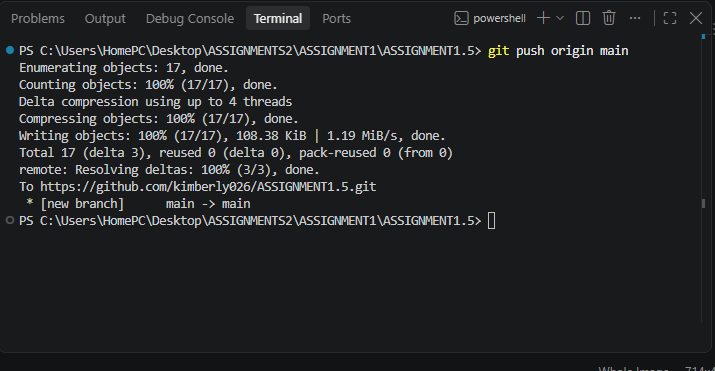
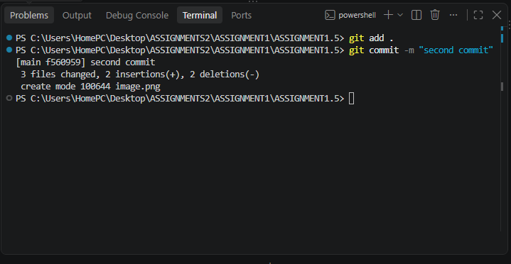

# Assignment 1.5 — GitHub Essentials II

## 1. Aim

To upload a local project to GitHub, connect a local Git repository to a remote repository, push files, create a second commit, and verify the commit history.

## 2. Requirements

- Git installed on the computer
- Visual Studio Code installed
- A GitHub account
- An internet connection
- A local project folder

## 3. Procedure

### Step 1: Create a GitHub Account

I visited [GitHub](https://github.com/) and signed in to my existing account.

### Step 2: Create a Public Repository

1. Click the **+** icon on GitHub.
2. Select **New repository**.
3. Enter the repository name: `Assignment-1.5`.
4. Select **Public**.
5. Click **Create repository**.

### Step 3: Create a Local Project

I created a folder named `Assignment-1.5` and added an HTML file named `index.html`.

### Step 4: Initialize Git and Create the First Commit

I opened the project folder in Visual Studio Code and executed these commands in the terminal:

```
git init
git add .
git commit -m "Initial commit"
```

**Explanation:**

- `git init` initializes a Git repository.
- `git add .` stages the project files.
- `git commit` saves a snapshot of the staged files.


### Step 5: Connect the Local Repository to GitHub

I connected my local repository to the remote GitHub repository using the following commands:

```
git branch -M main
git remote add origin https://github.com/Kimberly026/ASSIGNMENT1.5.git
```

The first command renames the branch to `main`. The second command links the local repository to GitHub.

### Step 6: Upload the Project to GitHub

I uploaded the project using:

```
git push -u origin main
```

This command uploads the local commits to GitHub and configures the upstream branch for future pushes.





### Step 7: Add a New File and Create the Second Commit

I created a new file named `index2.html` and added the required HTML code.

Then I executed these commands:

```
git add .
git commit -m "Add about page"
git push
```

**Explanation:**

- `git add .` stages the new file.
- `git commit -m "Add about page"` creates the second commit.
- `git push` uploads the changes to GitHub.



### Step 8: Verify the Commit History

I used the following command to view the commit history:

```
git log --oneline
```

This command displays the commit IDs and their messages in a concise format.


I also opened my GitHub repository in a browser and clicked the **Commits** link to verify that both commits were recorded.

## 4. Result

The local project was connected to a public GitHub repository and uploaded successfully. A new HTML file was added, a second commit was created, and the commit history was verified.

## 5. Conclusion

Through this assignment, I learned how to initialize a Git repository, connect it to GitHub, upload files using `git push`, create multiple commits, and verify the commit history. These skills are important for version control and collaborative software development.


